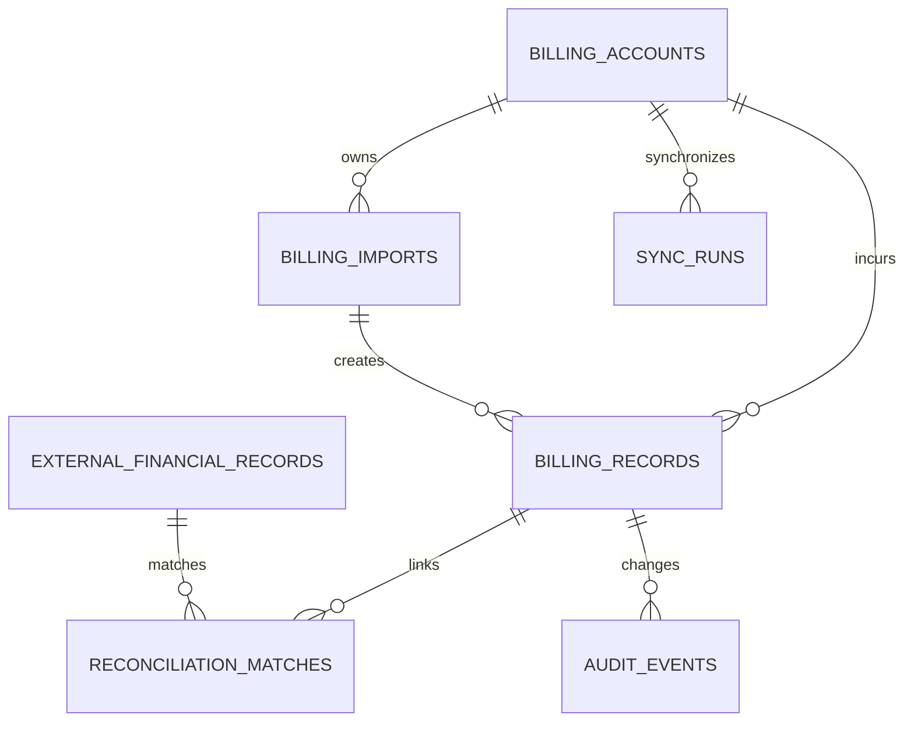

# Database Specification (DBS)

**Project:** Geidi AI Spend Manager  
**Ticket:** GEIDIMCP-102  
**Parent:** GEIDIMCP-49  
**Version:** 1.0 — Proposed Design  
**Date:** 2026-10-16  
**Status:** Draft, subject to existing GEIDIMCP-49 schema inspection  
**Owner:** Riel Jake Engaña  
**Reviewer:** Rey Nicko Santos

## 1. Purpose and boundaries

Specify a traceable and secure persistence model for authorized OpenAI/ChatGPT and Anthropic/Claude billing imports, API usage reports, invoice reconciliation, and monthly AI cost reports. **Extend the existing GEIDIMCP-49 database instead of automatically creating a second data store.** All names and SQL below are proposed, not confirmed existing tables.

In scope: billing account ownership, provider source metadata, immutable raw imports, invoices and line items, API consumption, payments/credits, reconciliation matches, sync activity, and audit history. Out of scope: supplier data and ITQuoter quotes, unauthorized personal accounts, changing third-party billing, or reconstructing confidential vendor internals.

## 2. Data-model rules

1. Never count an invoice, payment, credit purchase, and corresponding usage as four separate expenses.
2. Distinguish **invoice charges**, **cash payments**, and **API consumption** by `financial_basis` and report them separately.
3. Store monetary amounts as exact decimals; preserve original currency and conversion policy.
4. Preserve source lineage from every displayed financial figure to an authorized provider response or uploaded statement.
5. Permit partial/missing billing periods; never silently present incomplete figures as total spend.
6. Each import and provider sync must be idempotent, safely repeatable, and auditable.
7. Company versus explicitly authorized personal versus other-venture ownership must stay separate.
8. Store credentials in the existing secrets manager, **not in billing tables**.

## 3. Logical ERD

Names are logical entities; use existing GEIDIMCP-49 equivalents where available.

## 4. Proposed physical schema (PostgreSQL reference)

Use the database engine and migration framework already in GEIDIMCP-49; adapt PostgreSQL-specific features if different. UUID primary keys can be generated in application code or through a database extension approved by the team.

### 4.1 `billing_accounts`

| Column | Type | Constraints / meaning |
|---|---|---|
| id | UUID | Primary key |
| provider | VARCHAR(30) | NOT NULL; `openai`, `anthropic` |
| external_account_ref | VARCHAR(255) | Nullable; provider's stable reference |
| display_name | VARCHAR(255) | NOT NULL |
| ownership_type | VARCHAR(30) | NOT NULL; `geidi`, `personal_authorized`, `other_venture`, `unknown` |
| billing_currency | CHAR(3) | ISO 4217 code |
| active | BOOLEAN | NOT NULL DEFAULT TRUE |
| permission_reference | TEXT | Approval reference, **not** sensitive credentials |
| created_at / updated_at | TIMESTAMPTZ | NOT NULL |

**Unique where present:** `(provider, external_account_ref)`; confirm whether provider IDs are globally unique before enforcing this across organizations.

### 4.2 `billing_imports`

| Column | Type | Constraints / meaning |
|---|---|---|
| id | UUID | PK |
| account_id | UUID | FK -> billing_accounts.id |
| import_method | VARCHAR(20) | `api`, `pdf`, `csv`, `statement` |
| source_uri | TEXT | Restricted location or object key, not a public link |
| source_hash | CHAR(64) | SHA-256 of original file/payload, when available |
| provider_request_ref | VARCHAR(255) | Request/batch reference if present |
| period_start / period_end | DATE | Nullable pending validation |
| status | VARCHAR(30) | `received`, `processing`, `verified`, `partial`, `rejected` |
| imported_by | UUID | Nullable for service jobs; links to identity system |
| imported_at | TIMESTAMPTZ | NOT NULL |
| failure_reason | TEXT | Sanitized error message |

Add an appropriate duplicate-source constraint or reconciliation guard; identical files from different legitimately distinct account contexts must not be incorrectly merged.

### 4.3 `billing_records`

| Column | Type | Constraints / meaning |
|---|---|---|
| id | UUID | PK |
| account_id | UUID | FK -> billing_accounts.id |
| import_id | UUID | FK -> billing_imports.id |
| provider_record_ref | VARCHAR(255) | Nullable stable external ID |
| invoice_ref | VARCHAR(255) | Nullable invoice/statement number |
| category | VARCHAR(30) | `subscription`, `seat`, `api`, `codex`, `claude_code`, `credit`, `tax`, `adjustment`, `other` |
| financial_basis | VARCHAR(20) | **Required:** `invoiced`, `payment`, `consumption` |
| description | TEXT | Human-readable line-item description |
| period_start / period_end | DATE | NOT NULL after verification |
| original_amount | NUMERIC(20,6) | NOT NULL; signed, credits negative |
| original_currency | CHAR(3) | NOT NULL |
| validation_status | VARCHAR(20) | `pending`, `verified`, `disputed`, `rejected` |
| accounting_key | VARCHAR(255) | Stable logical charge identity when computable |
| created_at / updated_at | TIMESTAMPTZ | NOT NULL |

**Idempotency:** unique `(account_id, provider_record_ref, financial_basis)` for non-null stable provider references where sufficiently granular. Otherwise use a reviewed semantic key such as `(account_id, invoice_ref, category, period_start, line_number)`; add `line_number` if invoice lines can repeat. Never rely on amount+date alone to deduplicate.

### 4.4 `external_financial_records`

| Column | Type | Constraints / meaning |
|---|---|---|
| id | UUID | PK |
| source_system | VARCHAR(30) | e.g. `xero`, `card`, `manual` |
| external_ref | VARCHAR(255) | Unique within source scope |
| transaction_date | DATE | Transaction date |
| amount | NUMERIC(20,6) | Signed value |
| currency | CHAR(3) | ISO 4217 |
| account_owner | VARCHAR(30) | Company/personal/other venture, if verified |
| source_uri | TEXT | Restricted evidence reference |
| imported_at | TIMESTAMPTZ | NOT NULL |

**Do not** automatically count these records in the same expense total as provider invoices.

### 4.5 `reconciliation_matches`

| Column | Type | Constraints / meaning |
|---|---|---|
| id | UUID | PK |
| billing_record_id | UUID | FK -> billing_records.id |
| financial_record_id | UUID | FK -> external_financial_records.id |
| allocated_amount | NUMERIC(20,6) | Amount assigned to this match |
| status | VARCHAR(20) | `suggested`, `matched`, `partial`, `disputed` |
| reviewed_by | UUID | Nullable reviewer ID |
| reviewed_at | TIMESTAMPTZ | Nullable |
| rationale | TEXT | Reason / evidence |

Support one-to-many and many-to-one matches, partial invoices, bundled payments, refunds, and approval workflows. Compare currencies only after applying an approved currency-conversion method.

### 4.6 `sync_runs`

| Column | Type | Constraints / meaning |
|---|---|---|
| id | UUID | PK |
| account_id | UUID | FK -> billing_accounts.id |
| provider | VARCHAR(30) | Vendor |
| period_start / period_end | DATE | Requested window |
| started_at / finished_at | TIMESTAMPTZ | Start/end timestamps |
| status | VARCHAR(20) | `running`, `success`, `partial`, `failed` |
| record_count | INTEGER | Imported record count |
| cursor_state | TEXT | Non-secret continuation checkpoint |
| error_code | VARCHAR(100) | Safe error identifier |

### 4.7 `audit_events`

| Column | Type | Constraints / meaning |
|---|---|---|
| id | UUID | PK |
| actor_id | UUID | Nullable for service actor |
| entity_type / entity_id | VARCHAR(100) / UUID | Target |
| action | VARCHAR(100) | e.g. `import`, `verify`, `reconcile`, `delete_requested` |
| occurred_at | TIMESTAMPTZ | NOT NULL |
| metadata_json | JSONB | Redacted metadata; no secrets or full card data |

Audit history should be append-only to application users.

## 5. Reporting and aggregation

The primary management dashboard should display **monthly actual expense** based only on approved **invoiced charges** or another Finance-approved accounting basis. A separate consumption dashboard shows provider API usage; financial payments remain a separate cash-flow dimension. Define how sales tax, credits, prepaid purchases, refunds, and exchange rates affect the selected metric before writing SQL views.

Recommended aggregate views / queries:

- `monthly_actuals`: period, provider, account, currency, invoiced net amount, completeness.
- `monthly_consumption`: period, provider, consumption cost and currency.
- `unreconciled_charges`: verified provider records without approved reconciliation.
- `source_coverage`: account, month, expected sources, last sync/import, status.
- `provider_mix`: selected accounting basis, per-provider breakdown.

Never sum different currencies into one grand total without a documented FX rate source and conversion timestamp. For historical months with no source data, show **Unavailable** rather than zero.

## 6. Constraints and indexes

- Foreign keys on all account/import/reconciliation relations.
- Check constraints for supported `provider`, `ownership_type`, `financial_basis`, and lifecycle statuses (or reuse enum standards from the application).
- Check `period_end >= period_start` where both dates exist.
- Index `(account_id, period_start)`, `(financial_basis, validation_status, period_start)`, `(invoice_ref)`, and `(account_id, started_at DESC)` on sync runs.
- Unique source references for the proper external scope; use partial indexes for nullable keys where supported.
- Exact NUMERIC/DECIMAL arithmetic for money; no binary floating point.
- Use UTC timestamps in storage, with Asia/Manila only for display and agreed billing cutoffs.

## 7. Access control and privacy

- Reuse existing identity / permission roles: billing admin, Finance reviewer, authorized reporting viewer.
- Separate tenant, venture, and personal ownership; enforce visibility at query/service level and row-level policies if existing infrastructure supports them.
- Require Paul's documented explicit approval before personal accounts are onboarded.
- Store invoices in private, access-controlled object storage with signed short-lived access; database retains references and hashes.
- Keep API tokens in secret storage, never database rows, source metadata, logs, or browser bundles.
- Log who imported, viewed sensitive evidence, changed account ownership, and approved reconciliation.
- Define a Finance-approved retention period and deletion/legal-hold procedure before production.

## 8. Ingestion and data quality lifecycle

1. Validate authorization, account ownership, source type, and file/schema shape.
2. Save original source privately, hash it, and record an import job.
3. Extract provider/invoice ID, billing period, currency, line items, taxes and credits.
4. Cross-check invoice line sum versus provider invoice total; flag discrepancies.
5. Normalize transaction types without overwriting original evidence.
6. Upsert using provider IDs or invoice semantic identifiers; mark uncertain duplicates for review.
7. Reconcile matching bank/Xero entries as **evidence**, not additional costs.
8. Publish only eligible verified charges, and show partial/blocked source coverage.
9. Record import and approval events in the audit log.

Automated extractors/LLMs cannot invent missing amounts, IDs or dates. Uncertain extraction requires manual verification.

## 9. Migration and rollout

**Pre-migration gate:** inspect existing GEIDIMCP-49 tables, migrations, identifiers, auth policies, exports, and reports; produce a mapping from this proposed model to existing structures. Avoid dropping, renaming, or overwriting production objects without approval.

- Version migrations; test on a sanitized staging backup.
- Deploy additive tables/columns first, then backfill historical data in resumable batches.
- Add uniqueness constraints after duplicate profiling/cleanup.
- Verify report totals before switching reads to new views.
- Keep schema and application rollback steps; back up before rollout.
- Existing reporting must continue when a connector is disabled or fails.

## 10. Database acceptance tests

| ID | Scenario | Expected result |
|---|---|---|
| DB-01 | Re-import same invoice PDF | No duplicated charge; import evidence preserved |
| DB-02 | Retry API sync after timeout | Upsert produces stable record counts |
| DB-03 | Same amount on two valid invoice lines | Both legitimate charges retained |
| DB-04 | Purchase $100 prepaid credit, consume $30 | Reports distinguish cash paid and consumption; no $130 double-count |
| DB-05 | Missing source for September | Coverage marked unavailable/partial, not $0 |
| DB-06 | USD and PHP records | Separate currencies until approved FX conversion |
| DB-07 | Personal account without permission | Onboarding / retrieval rejected |
| DB-08 | Invoice paid in multiple transactions | Partial/multiple reconciliation links supported |
| DB-09 | Unauthorized user requests invoice | Access denied and event logged |
| DB-10 | Verify invoice line totals | Mismatch flagged before publication |
| DB-11 | Credit or refund imported | Sign and accounting treatment validated |
| DB-12 | Historical migration | Verified existing totals unchanged |

## 11. Dependencies / open decisions

- Existing database engine, naming conventions, migrations, and tenancy model for GEIDIMCP-49.
- Whether each provider exposes the necessary billing details for the actual Geidi account plan.
- Approved credentials, accessible invoices, reconciliation records, and retention requirements.
- Finance definition of **actual expenses**, taxes, credits, prepaid usage, and reporting currency.
- Existing dashboard query contracts and historical reporting requirements.

**Definition of Done:** physical schema mapped to the inspected codebase; reviewed migrations; idempotent import tests; restricted access; auditable totals; Finance-validated expense accounting; monthly/12-month reports showing completeness; Nicko sign-off.

---

**Document status:** Proposed database specification; not evidence of implemented tables or completed integration.
